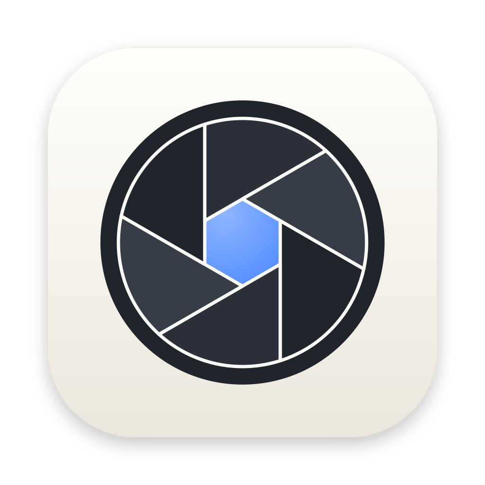

<p align="center">
  
</p>

<h1 align="center">OShot</h1>

<p align="center">
  A fast, free and open source screenshot and markup app for macOS.<br>
  Capture, annotate, and copy or save in a few keystrokes.
</p>

<p align="center">
  <a href="LICENSE"></a>
  
  
  
</p>

---

> [!WARNING]
> **OShot is in beta (v0.0.1).** I built it to fix my own workflow after getting
> fed up with the built in macOS screenshot tool. Expect rough edges and bugs.
> Feedback is very welcome: please [open an issue](../../issues) for anything
> that breaks or feels wrong, and pull requests are welcome.
>
> If OShot is useful to you, please give it a ⭐ on GitHub. It helps other
> people find it.

## Why OShot

The best screenshot tools on the Mac, such as CleanShot X, Shottr, Snagit and
Xnapper, are paid and closed source. OShot aims to cover the same everyday
workflow (grab a part of the screen, draw arrows and boxes on it, blur the
secrets, paste it into Slack) without a licence key, an account, or a subscription.

- **Free and open source.** MIT licensed. Read it, fork it, ship it.
- **Native and fast.** Written in Rust on [GPUI](https://gpui.rs), the
  GPU accelerated UI framework behind the [Zed](https://zed.dev) editor, with
  ScreenCaptureKit, Vision and ImageIO doing the macOS side.
- **Private.** Everything stays on your Mac. No cloud upload, no telemetry.
- **Mac only, for now.** Windows and Linux versions are coming in the near
  future.

## Features

### Capture

- Area, window, full screen, delayed (3, 5 or 10 seconds) and repeat last area.
- Press **both ⌘ keys together** to open the capture menu, then a number key:
  1 Area, 2 Window, 3 Screen, 4 Text, 5 Timer, 6 Color, 7 Ruler, 8 Convert.
- Window capture works like macOS's own: the window under the pointer is
  tinted and captured on its own, with or without its shadow.
- **Text capture (OCR):** drag over any text on screen and it is copied.
- Screen colour picker, and a ruler that measures the gap between things.
- While selecting: ⌘C copies, ⌘S saves, ↩ opens the editor, A snaps the
  selection to its content, Esc cancels.

### Annotate

- Arrows (tapered, line or double), lines, rectangles, ovals, freehand,
  highlighter, text, numbered steps, pixelate, blur, erase, spotlight,
  magnifier and ruler, with an optional hand drawn style and full undo.
- Arrows pick black or white automatically based on the image behind them.
- **Arrow labels:** draw an arrow and press T to type a label at its tail.
  Turn on Numbered and arrows get step badges ("1. this is misaligned") that
  count together with step counters.
- Text remembers its colour, size and style between editors and launches.
- Drawings stay inside the image, or turn on Extend canvas to let the image
  grow around them.
- Crop, backdrop (gradient, padding, rounded corners, shadow), resize, pin to
  screen, paste an image on top, and before/after GIF.
- **Auto redact** emails, API keys, tokens and card numbers.

### Export

- PNG, JPEG, WebP, HEIC, AVIF, TIFF and GIF, with lossless PNG shrinking.
- Copy as image, file, file path or Base64.
- **Image converter** (menu bar, capture menu, or Finder › Quick Actions ›
  Convert with OShot) with quality, max size, Retina to 1x and metadata
  removal.

### Organise

- Recent captures in the menu bar.
- Moves macOS's own screenshots off your Desktop, and can clean up old
  captures automatically.

## Shortcuts

| Action | Default |
| --- | --- |
| Capture menu | both ⌘ keys, or ⌥⇧5 |
| Capture full screen | ⌥⇧3 |
| Capture area | ⌥⇧4 |
| Capture window | ⌥⇧6 |
| Capture text (OCR) | ⌥⇧7 |

All of these can be changed in **Settings › Shortcuts**.

In the editor, ⌘C copies the image and closes the editor. Turn off
**Settings › General › Close editor after ⌘C** to keep it open. The **Copy**
button always keeps it open.

## Install

OShot needs **macOS 26 (Tahoe) or later**.

> [!IMPORTANT]
> OShot is not signed with an Apple Developer ID or notarised by Apple, because
> that requires a paid Apple developer account. macOS will warn you the first
> time you open it. The steps below get past that warning once. If you would
> rather not trust a prebuilt binary, [build it from source](#build-from-source)
> instead; it takes a few minutes.

### Download a release

1. Download `OShot.zip` from the [latest release](../../releases/latest) and
   unzip it. The prebuilt app is for Apple Silicon Macs.
2. Drag `OShot.app` into your **Applications** folder.
3. Open it. macOS says it *"cannot verify that OShot is free of malware"*.
   Click **Done** (not Move to Trash).
4. Open **System Settings › Privacy & Security**, scroll to the bottom, and
   click **Open Anyway** next to the OShot message. Confirm with your password
   or Touch ID. You only need to do this once.

   Prefer the Terminal? This removes the download quarantine flag and does the
   same thing:

   ```sh
   xattr -dr com.apple.quarantine /Applications/OShot.app
   ```

5. On the first capture, macOS asks for **Screen Recording** permission. Allow
   it in System Settings, then reopen OShot. The both ⌘ keys gesture also needs
   **Accessibility** permission. OShot walks you through both.

> [!NOTE]
> After installing a new version you may need to grant Screen Recording again.
> macOS ties that permission to the app's code signature, and builds without a
> developer certificate get a new signature every time. If captures come back
> blank after an update, remove OShot from **Privacy & Security › Screen &
> System Audio Recording**, add it again, and relaunch.

### Build from source

You need:

- macOS 26 or later
- Xcode (for the Metal shader toolchain GPUI uses)
- [Rust](https://rustup.rs). The exact version is pinned in
  `rust-toolchain.toml` and installs itself on the first build.

```sh
xcodebuild -downloadComponent MetalToolchain   # once
git clone https://github.com/selzer25/OShot.git
cd OShot
OSHOT_SIGN_IDENTITY=- ./scripts/bundle.sh       # builds and signs dist/OShot.app
cp -R dist/OShot.app /Applications/
open /Applications/OShot.app
```

The first build downloads and compiles GPUI and takes a few minutes. Later
builds are much faster.

`OSHOT_SIGN_IDENTITY=-` signs the app *ad hoc* (a local signature that needs no
Apple account). Because you built it yourself, macOS does not quarantine it and
no Gatekeeper warning appears. If you have a free or paid **Apple Development**
certificate in your keychain, leave the variable out and the script uses it;
macOS then keeps the Screen Recording permission across rebuilds.

## Development

```sh
cargo test --workspace                                          # all tests
cargo clippy --workspace --all-targets                          # lint, must be warning free
cargo fmt --all                                                 # format
cargo test --release -p oshot-app --test visual -- --nocapture  # screenshots and frame timing
```

The app tests drive real mouse and keyboard events through GPUI's test platform
against a fake macOS layer, so they need no permissions. The visual test writes
screenshots of every window, in light and dark mode, to `target/ui-snapshots/`.

### Layout

| Crate | What it holds |
| --- | --- |
| `crates/oshot-core` | Annotation model, drawing primitives, effects, ruler, formats, settings. Pure Rust. |
| `crates/oshot-native` | CoreGraphics export, ImageIO conversion, WebP, PNG shrinking, Vision OCR. |
| `crates/oshot-app` | The GPUI app and the macOS platform layer. |

## Contributing

OShot is in beta, so feedback of any kind helps. Found a bug, hit something
confusing, or want a feature? [Open an issue](../../issues). Pull requests are
welcome too. Before opening a PR, please make sure
`cargo clippy --workspace --all-targets` is warning free and
`cargo test --workspace` passes. New clickable controls should carry a
`.debug_selector(...)` so the flow tests can find them.

## Support the project

If OShot saves you time, please give the repository a ⭐. It is the easiest
way to help, and it tells me the project is worth more of my time.

## License

[MIT](LICENSE). Icons are from [Lucide](https://lucide.dev) (ISC, see
`crates/oshot-app/assets/icons/LICENSE-lucide`).
